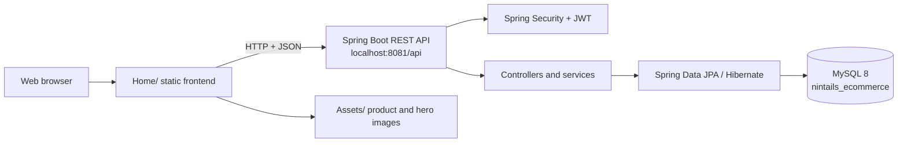
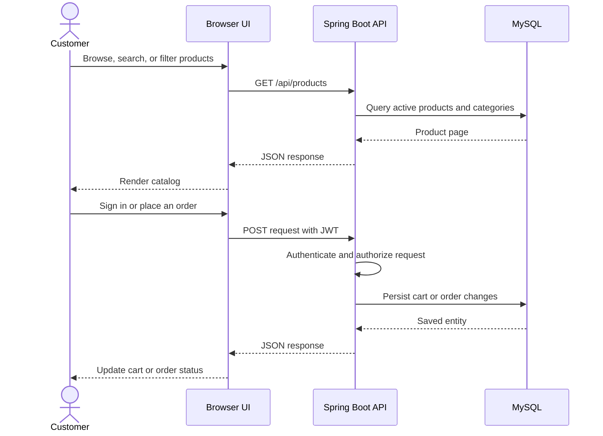
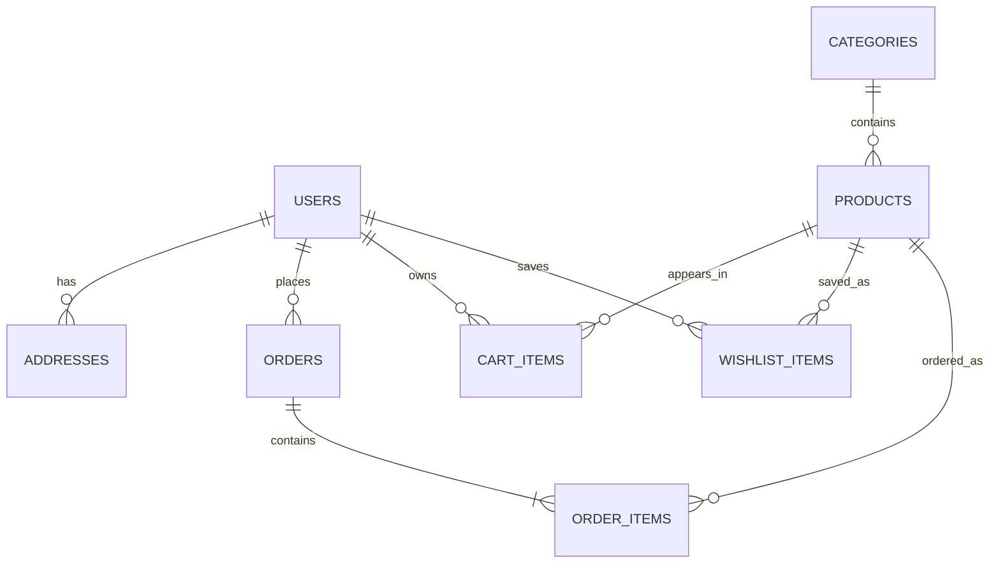

# 9Tails Ecommerce

A full-stack ecommerce web application with a vanilla HTML/CSS/JavaScript storefront and a Spring Boot REST API backed by MySQL.

Repository: https://github.com/DuddeJaitej/9Tails-Ecommerce-WebApp

## Architecture



### Request flow



### Database relationships



## Tech Stack

**Frontend**
- Vanilla HTML5, CSS3, JavaScript (no frameworks)
- Responsive design with CSS custom properties
- JWT authentication, localStorage + API hybrid data layer

**Backend**
- Spring Boot 3.2.5 + Java 21
- Spring Security + JWT (stateless)
- Hibernate / Spring Data JPA
- MySQL 8 database
- Maven 3.9

## Features

- Product catalog with categories, search, filters and ratings
- Product detail page with single image view
- Shopping cart with quantity controls
- Order placement (COD + UPI via Razorpay)
- Order tracking with 4-step shipping timeline
- Cancel / Return / Exchange order actions
- Wishlist management
- User authentication (register / login / Google OAuth)
- Admin product & category management

## Project Structure

```
Ecommerce/
├── Home/                         # Frontend pages, styles, and browser logic
│   ├── Home.html                 # Storefront and catalog
│   ├── Cart.html                 # Shopping cart
│   ├── Orders.html               # Customer orders
│   ├── OrderTracking.html        # Shipment timeline
│   ├── ProductDetail.html        # Product detail view
│   ├── api.js                    # Centralized API client
│   ├── auth.js                   # JWT and session helpers
│   ├── products-data.js          # Frontend product fallback data
│   └── *.css / *.js              # Page-specific presentation and behavior
├── Assets/                       # Product, hero, and order-support images
├── backend/
│   ├── src/main/java/com/nintails/ # REST controllers, services, entities, security
│   ├── src/main/resources/        # Spring Boot configuration
│   ├── database/schema.sql        # MySQL schema and seed data
│   └── pom.xml                    # Maven dependencies and build configuration
├── start.ps1                      # Windows launcher for MySQL, API, and frontend
└── README.md
```

## Prerequisites

Install these tools before starting:

- **Git** — to clone the repository.
- **Java JDK 21** — verify with `java -version`.
- **Apache Maven 3.9 or later** — verify with `mvn -version`.
- **MySQL Server 8 or later** — the backend connects to MySQL on `localhost:3306`.
- **Python 3** — used to serve the static frontend; verify with `python --version`.
- **MySQL Workbench** (recommended) — an easy way to run the included database script.

The commands below use Windows PowerShell. On macOS or Linux, use your terminal and equivalent environment-variable syntax. The Windows `start.ps1` helper is optional; the manual steps work independently of it.

## Get the project

Open PowerShell in the folder where you keep projects:

```powershell
git clone https://github.com/DuddeJaitej/9Tails-Ecommerce-WebApp.git
cd 9Tails-Ecommerce-WebApp
```

To get future updates:

```powershell
git pull
```

Alternatively, download the ZIP from the [GitHub repository](https://github.com/DuddeJaitej/9Tails-Ecommerce-WebApp), extract it, and open the extracted project folder in your terminal or editor. Git is recommended for easy updates.

## Run locally

The backend needs a running MySQL server. Start the backend and frontend in two separate terminals, and leave both running while using the app.

### 1. Create and seed the database

1. Start MySQL Server.
2. Open `backend/database/schema.sql` in MySQL Workbench.
3. Connect to your local MySQL server and execute the entire script.

The script creates the `nintails_ecommerce` database, its tables, and sample data. The backend uses the local MySQL account `root` by default and updates the schema on startup.

### 2. Configure and start the backend

In the first PowerShell terminal, from the project root, set the database password and a local JWT signing key. Replace the database password with the one configured for your MySQL `root` account. Keep these values local; do not commit them.

```powershell
$env:DB_PASSWORD = "your-local-mysql-root-password"
$env:JWT_SECRET = "replace-with-a-random-secret-at-least-32-characters-long"
```

If the local MySQL `root` account has no password, set `$env:DB_PASSWORD = ""`.

Then start the Spring Boot API:

```powershell
cd backend
mvn spring-boot:run
```

On the first run, Maven downloads the backend dependencies. Wait for Spring Boot to report that it has started. The API base URL is `http://localhost:8081/api`.

### 3. Start the frontend

Open a **second** PowerShell terminal at the project root (the folder containing `Home` and `Assets`) and run:

```powershell
python -m http.server 5500
```

Open [http://localhost:5500/Home/Home.html](http://localhost:5500/Home/Home.html) in your browser. Keep both terminals running. Do not open `Home/Home.html` directly using a `file://` URL; the local web server is needed for images and API requests.

### Optional: Windows one-command launcher

`start.ps1` can open the backend and frontend for you. First set `DB_PASSWORD` and `JWT_SECRET` in the PowerShell session, then run it from the project root:

```powershell
.\start.ps1
```

The script expects a Windows MySQL service named `MySQL80` and the ports `8081` and `5500` to be available. It attempts to stop processes already listening on those ports, so use the manual steps above if you already have services running there. If PowerShell blocks the script, allow it only for the current session:

```powershell
Set-ExecutionPolicy -Scope Process -ExecutionPolicy Bypass
.\start.ps1
```

## Local URLs

| Component | URL |
|-----------|-----|
| Storefront | http://localhost:5500/Home/Home.html |
| API base URL | http://localhost:8081/api |
| Product catalog API | http://localhost:8081/api/products |

## API overview

All endpoints are under `/api`. Endpoints marked **Authenticated** require a valid JWT.

| Method | Endpoint | Access | Description |
|--------|----------|--------|-------------|
| POST | `/api/auth/register` | Public | Register a user |
| POST | `/api/auth/login` | Public | Sign in and receive a JWT |
| POST | `/api/auth/google` | Public | Sign in with Google |
| GET | `/api/products` | Public | List products |
| GET | `/api/products/{id}` | Public | Get product details |
| GET | `/api/cart` | Authenticated | Get the signed-in user's cart |
| POST | `/api/cart` | Authenticated | Add an item to the cart |
| POST | `/api/orders` | Authenticated | Place an order |
| GET | `/api/orders` | Authenticated | List the signed-in user's orders |
| GET | `/api/wishlist` | Authenticated | Get the signed-in user's wishlist |

## Development admin account

The included sample data provides a development admin account: `admin@9tails.com` / `Admin@123`. Use it only on a local development database, and change or remove it before deploying or exposing the application to other users. Never reuse this password in a production environment.

## Troubleshooting

- **Database connection fails:** confirm MySQL is running, the schema script completed, and `DB_PASSWORD` matches the local MySQL `root` password in the backend terminal.
- **The storefront cannot load products:** keep the backend terminal running and check that `http://localhost:8081/api/products` opens.
- **Images do not load:** make sure Python is serving from the repository root, not from inside `Home`.
- **A port is already in use:** stop the application using port `8081` or `5500`, or use the manual startup steps after freeing the port.
- **Google sign-in is unavailable:** configure a Google OAuth client for your local origin; browsing and other public catalog features do not require signing in.

## Build and test the backend

From the project root:

```powershell
cd backend
mvn clean verify
```
