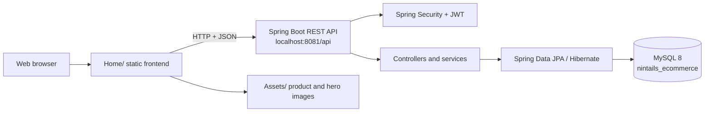
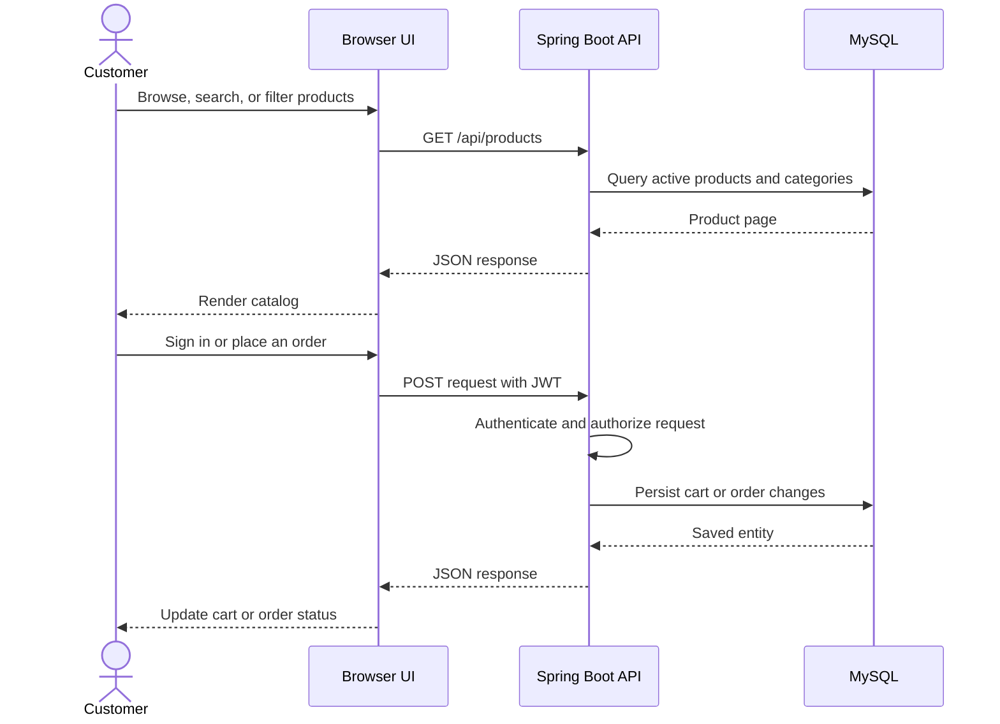
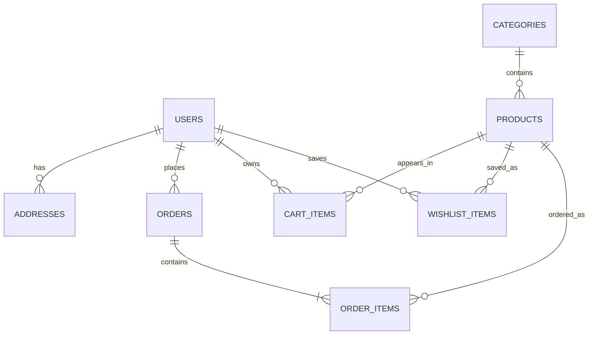

# 9Tails Ecommerce

A full-stack ecommerce web application with a vanilla HTML/CSS/JavaScript storefront and a Spring Boot REST API backed by MySQL.

Repository: https://github.com/DuddeJaitej/9Tails-Ecommerce-WebApp

## Architecture



### Request flow



### Database relationships



## Tech Stack

**Frontend**
- Vanilla HTML5, CSS3, JavaScript (no frameworks)
- Responsive design with CSS custom properties
- JWT authentication, localStorage + API hybrid data layer

**Backend**
- Spring Boot 3.2.5 + Java 21
- Spring Security + JWT (stateless)
- Hibernate / Spring Data JPA
- MySQL 8 database
- Maven 3.9

## Features

- Product catalog with live name suggestions, category, price-range and star-rating filters
- Product detail page with single image view
- Shopping cart with quantity controls
- Order placement (COD + UPI via Razorpay)
- Order tracking with 4-step shipping timeline
- Cancel / Return / Exchange order actions
- Wishlist management
- User authentication (register / login / Google OAuth)
- Operations Studio business-owner self-registration and role-based sign-in
- Admin product & category management
- Admin dashboard with verified revenue, order/payment analytics, order status updates, inventory and customer activity

## Project Structure

```
Ecommerce/
├── Home/                         # Frontend pages, styles, and browser logic
│   ├── Home.html                 # Storefront and catalog
│   ├── Admin.html                # Administrator analytics dashboard
│   ├── Cart.html                 # Shopping cart
│   ├── Orders.html               # Customer orders
│   ├── OrderTracking.html        # Shipment timeline
│   ├── ProductDetail.html        # Product detail view
│   ├── api.js                    # Centralized API client
│   ├── auth.js                   # JWT and session helpers
│   ├── products-data.js          # Frontend product fallback data
│   └── *.css / *.js              # Page-specific presentation and behavior
├── Assets/                       # Product, hero, and order-support images
├── backend/
│   ├── src/main/java/com/nintails/ # REST controllers, services, entities, security
│   ├── src/main/resources/        # Spring Boot configuration
│   ├── database/schema.sql        # MySQL schema and seed data
│   └── pom.xml                    # Maven dependencies and build configuration
├── start.ps1                      # Windows launcher for MySQL, API, and frontend
└── README.md
```

## Prerequisites

Install these tools before starting:

- **Git** — to clone the repository.
- **Java JDK 21** — verify with `java -version`.
- **Apache Maven 3.9 or later** — verify with `mvn -version`.
- **MySQL Server 8 or later** — the backend connects to MySQL on `localhost:3306`.
- **Python 3** — used to serve the static frontend; verify with `python --version`.
- **MySQL Workbench** (recommended) — an easy way to run the included database script.

The commands below use Windows PowerShell. On macOS or Linux, use your terminal and equivalent environment-variable syntax. The Windows `start.ps1` helper is optional; the manual steps work independently of it.

## Get the project

Open PowerShell in the folder where you keep projects:

```powershell
git clone https://github.com/DuddeJaitej/9Tails-Ecommerce-WebApp.git
cd 9Tails-Ecommerce-WebApp
```

To get future updates:

```powershell
git pull
```

Alternatively, download the ZIP from the [GitHub repository](https://github.com/DuddeJaitej/9Tails-Ecommerce-WebApp), extract it, and open the extracted project folder in your terminal or editor. Git is recommended for easy updates.

## Run locally

The backend needs a running MySQL server. Start the backend and frontend in two separate terminals, and leave both running while using the app.

### 1. Create and seed the database

1. Start MySQL Server.
2. Open `backend/database/schema.sql` in MySQL Workbench.
3. Connect to your local MySQL server and execute the entire script.
4. The backend automatically applies `backend/database/delivery_workflow_migration.sql`
   at startup before seeding accounts or accepting requests. Ensure the MySQL account
   configured for the backend can alter tables; MySQL 8.0 or later is required.

The schema script creates the `nintails_ecommerce` database and sample catalog. The workflow
migration adds owner, delivery, warehouse, notification, verification, and inventory-reservation
tables/columns. Back up existing installations before starting the updated backend so its
automatic migration can update the schema. The backend uses the local MySQL account `root` by
default and Hibernate updates mapped tables on startup.

The application no longer rewrites the hard-coded demo catalog on every startup. It is disabled
by default; set `SEED_DEMO_DATA=true` only for disposable local demos.

### 2. Configure and start the backend

In the first PowerShell terminal, from the project root, set the database password and a local JWT signing key. Replace the database password with the one configured for your MySQL `root` account. Keep these values local; do not commit them.

```powershell
$env:DB_PASSWORD = "your-local-mysql-root-password"
$env:JWT_SECRET = "replace-with-a-random-secret-at-least-32-characters-long"
```

`JWT_SECRET` must contain at least 32 UTF-8 bytes. The backend now checks this when it starts so an invalid key does not make every sign-in fail later.

Set your private admin credentials in the ignored `backend/.env` file:

```properties
ADMIN_EMAIL=your-admin-email@example.com
ADMIN_PASSWORD=use-a-unique-password-with-at-least-12-characters
```

The backend creates this account with the administrator role and applies the configured password at startup. Existing installations with the old built-in development password have that known password disabled; set these values before restarting to sign in with your own credentials.
Admin bootstrap requires a valid email and a password of at least 12 characters. If either setting is missing or invalid, startup logs a warning, does not create or reset an admin account, and continues starting the API.
For an existing administrator account whose password is unknown, set `ADMIN_EMAIL` to that
account's email, choose a new `ADMIN_PASSWORD`, and set
`ADMIN_PASSWORD_RESET_ON_STARTUP=true` in the ignored `backend/.env`. Restart the backend once to
apply the reset, then set the flag back to `false` and restart again. Do not leave this one-time
reset enabled.
On Windows, you can instead run `.\reset-admin-password.ps1` from `backend`; it securely prompts
for the email and new password, validates the password length before starting, and applies the
reset flag only to that startup process.
The first administrator can be registered from the Admin sign-in page only when the database
has no administrator yet. Alternatively, provision that first account using the private
`ADMIN_EMAIL` and `ADMIN_PASSWORD` settings.
Businesses can create owner accounts from the Operations Studio sign-in page using the
**Create business account** form. New self-registrations receive only the OWNER role.
Administrators can use the same sign-in form without selecting an account type.

For Razorpay Test Mode, run `.\configure-razorpay.ps1` from the `backend` folder and enter your rotated Key ID and Key Secret when prompted. The secret prompt is hidden. This updates only the Razorpay entries in the ignored `backend/.env`, preserving your admin credentials and other settings. Never commit `.env` or put the Razorpay secret in frontend code. Restart the backend after configuring or rotating keys.

If the local MySQL `root` account has no password, set `$env:DB_PASSWORD = ""`.

Then start the Spring Boot API:

```powershell
cd backend
mvn spring-boot:run
```

On the first run, Maven downloads the backend dependencies. Wait for Spring Boot to report that it has started. The API base URL is `http://localhost:8081/api`.

### 3. Start the frontend

Open a **second** PowerShell terminal at the project root (the folder containing `Home` and `Assets`) and run:

```powershell
python -m http.server 5500
```

Open [http://localhost:5500/Home/Home.html](http://localhost:5500/Home/Home.html) in your browser. Keep both terminals running. Do not open `Home/Home.html` directly using a `file://` URL; the local web server is needed for images and API requests.

For testing on a phone connected to the same Wi-Fi, start the frontend server with
`python -m http.server 5500 --bind 0.0.0.0` and open
`http://<computer-wi-fi-ip>:5500/Home/Delivery.html` on the phone (for example,
`http://192.168.1.13:5500/Home/Delivery.html`). The API client uses the frontend hostname
for port 8081, and local CORS permits the `192.168.1.*` subnet. Allow inbound TCP ports
5500 and 8081 on Windows Firewall for a private network. Phone camera access still requires
HTTPS; use manual token entry when testing over plain HTTP.

Use `Home/Operations.html` to assign existing catalog products to owners. Owners must first add
a confirmed pickup location. The same page provides owner product management and fulfillment
tasks. Warehouse operators can self-register a hub at `Home/DeliveryRegister.html`; the hub
remains inactive until an administrator approves its address and map location in
`Home/Admin.html`. Delivery agents register by choosing an approved hub and remain inactive
until that hub's operator approves them. No administrator invitation code is required.

After an owner confirms an order, the delivery route uses the nearest approved warehouse to
the seller as its origin and the nearest approved warehouse to the customer as its destination.
The origin warehouse operator assigns a pickup agent. Once that agent checks the package into
the origin warehouse, that warehouse operator assigns a different transfer agent when the route
uses two hubs. The transfer agent scans the package QR to start the origin-to-destination leg and
scans the destination warehouse's separate arrival QR to confirm the handoff. The destination
warehouse operator then assigns a different final-delivery agent to carry the package to the
customer. When origin and destination are the same warehouse, the transfer leg is skipped, but
the warehouse still assigns a distinct final-delivery agent. Each agent accepts a one-minute
offer and has 24 hours to complete their assigned leg. The customer timeline advances only after
the corresponding server-validated scan or warehouse check-in. Pickup, delivery-address, and
warehouse-location forms preview selected coordinates in Google Maps; delivery routes open
externally using the saved coordinates. The map embeds do not require a Google Maps API key.
Address lookup continues to use OpenStreetMap's Nominatim search service.
After the delivery handoff, the customer still confirms receipt from their order page.
QR camera scanning requires HTTPS or localhost; manual token entry is available otherwise.
Product uploads are stored under `uploads/products` unless `app.upload.dir` is set to a
persistent production location. Paid-order cancellations
or seller rejections require administrator refund review; refunds are not automatically issued.

### Test Razorpay Checkout

1. Rotate any Razorpay secret that has been shared, then use the new **Test Mode** keys.
2. Copy `backend/.env.example` to `backend/.env` and set `RAZORPAY_KEY_ID` and `RAZORPAY_KEY_SECRET`. Keep `.env` local; the secret is only read by Spring Boot.
3. Restart the backend and serve the frontend as described above.
4. Open [http://127.0.0.1:5500/Home/Cart.html](http://127.0.0.1:5500/Home/Cart.html), sign in, add products and a saved address, select **UPI / Cards**, then click **Proceed to Checkout** and **Pay Now**.
5. Complete a Razorpay test payment. The app verifies the returned signature on the backend, confirms the order, displays the congratulations message, and redirects to `Orders.html`. Closing Checkout or a failed payment does not mark the order paid.

The amount and currency are calculated by the backend from the signed-in customer's cart. A Razorpay test account must be configured to use the UPI methods you want to test; payment-method and QR availability are controlled by Razorpay Checkout and account settings.

### Optional: Windows one-command launcher

`start.ps1` can open the backend and frontend for you. First set `DB_PASSWORD` and `JWT_SECRET` in the PowerShell session, then run it from the project root:

```powershell
.\start.ps1
```

The script expects a Windows MySQL service named `MySQL80` and the ports `8081` and `5500` to be available. It attempts to stop processes already listening on those ports, so use the manual steps above if you already have services running there. If PowerShell blocks the script, allow it only for the current session:

```powershell
Set-ExecutionPolicy -Scope Process -ExecutionPolicy Bypass
.\start.ps1
```

## Local URLs

| Component | URL |
|-----------|-----|
| Storefront | http://localhost:5500/Home/Home.html |
| Admin dashboard | http://localhost:5500/Home/Admin.html |
| API base URL | http://localhost:8081/api |
| Product catalog API | http://localhost:8081/api/products |

## API overview

All endpoints are under `/api`. Endpoints marked **Authenticated** require a valid JWT.

| Method | Endpoint | Access | Description |
|--------|----------|--------|-------------|
| POST | `/api/auth/register` | Public | Register a user |
| POST | `/api/auth/login` | Public | Sign in and receive a JWT |
| POST | `/api/auth/google` | Public | Sign in with Google |
| GET | `/api/products` | Public | List products |
| GET | `/api/products/{id}` | Public | Get product details |
| GET | `/api/cart` | Authenticated | Get the signed-in user's cart |
| POST | `/api/cart` | Authenticated | Add an item to the cart |
| POST | `/api/orders` | Authenticated | Place an order |
| GET | `/api/orders` | Authenticated | List the signed-in user's orders |
| GET | `/api/wishlist` | Authenticated | Get the signed-in user's wishlist |
| GET | `/api/admin/dashboard` | Admin | Load revenue, order/payment charts and store metrics |
| GET | `/api/admin/orders?page=0&size=20` | Admin | Browse all transactions; update fulfillment status from the dashboard |
| GET | `/api/admin/inventory?page=0&size=20` | Admin | Browse active products and stock |
| GET | `/api/admin/customers?page=0&size=20` | Admin | Browse registered customers |

## Admin dashboard sign-in

Customer registration/login and administrator sign-in are separate. Public administrator signup
is limited to initial setup: when the database has no administrator, the Admin sign-in page shows
a first-admin registration form; it closes automatically once an admin account exists. You can
also set `ADMIN_EMAIL` and `ADMIN_PASSWORD` in the ignored `backend/.env` file to provision an
initial administrator. Signed-in administrators can create additional administrators from
`Home/AdminRegister.html` or the Owners & delivery staff panel in the Admin dashboard. Use
`Home/Operations.html` to assign owner, delivery-agent, and warehouse roles to existing accounts.
Admin tokens and customer sessions are stored separately. Configure `SMTP_HOST`, `SMTP_PORT`, `SMTP_USERNAME`,
`SMTP_PASSWORD`, and `SMTP_FROM` in `backend/.env` to enable one-time email password-reset links
for both admin accounts and storefront customers (30-minute reset-link expiry). Set
`CUSTOMER_PASSWORD_RESET_URL` if the storefront is served at a different URL. The dashboard includes sales/order charts, paginated transactions,
inventory and customer records; admins can update order fulfillment status.
Revenue counts orders whose payment status is `PAID`; pending, failed, cancelled and other order
records remain stored and visible in order history.

## Troubleshooting

- **Database connection fails:** confirm MySQL is running, the schema script completed, and `DB_PASSWORD` matches the local MySQL `root` password in the backend terminal.
- **The storefront cannot load products:** keep the backend terminal running and check that `http://localhost:8081/api/products` opens.
- **Images do not load:** make sure Python is serving from the repository root, not from inside `Home`.
- **A port is already in use:** stop the application using port `8081` or `5500`, or use the manual startup steps after freeing the port.
- **Google sign-in is unavailable:** configure a Google OAuth client for your local origin; browsing and other public catalog features do not require signing in.

## Build and test the backend

From the project root:

```powershell
cd backend
mvn clean verify
```
